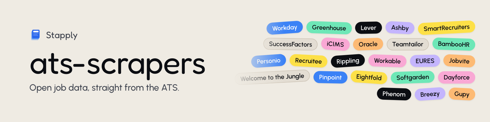
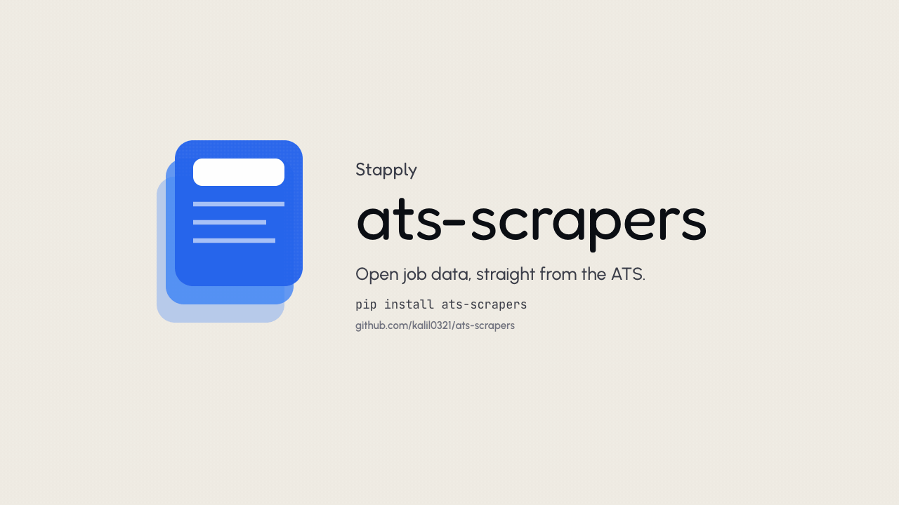

<p align="center">
  <picture>
    <source media="(prefers-color-scheme: dark)" srcset="https://raw.githubusercontent.com/kalil0321/ats-scrapers/main/assets/banner-dark.png">
    
  </picture>
</p>

<p align="center">
  One Python library for job postings from as many sources as possible: ATS platforms,
  company career APIs and public job services. We keep the scrapers working and publish
  everything they collect as a free dataset. Part of <a href="https://stapply.ai">Stapply</a>.
</p>

<p align="center">
  <a href="https://data.stapply.ai">Browse the data</a> ·
  <a href="https://map.stapply.ai">Live map</a> ·
  <a href="https://github.com/kalil0321/ats-scrapers/blob/main/docs/JOB_SCHEMA.md">Job schema</a> ·
  <a href="https://www.stapply.ai/api?utm_source=readme">Hosted API waitlist</a>
</p>

<p align="center">
  <a href="https://storage.stapply.ai/jobs/v1/manifest.json"></a>
  <a href="https://storage.stapply.ai/jobs/v1/manifest.json"></a>
  <a href="https://storage.stapply.ai/jobs/v1/manifest.json"></a>
  <a href="https://storage.stapply.ai/jobs/v1/manifest.json"></a>
  <a href="https://pypi.org/project/ats-scrapers/"></a>
  <a href="https://pypi.org/project/ats-scrapers/"></a>
  <a href="https://github.com/kalil0321/ats-scrapers/blob/main/LICENSE"></a>
</p>

<p align="center">
  <picture>
    <source media="(prefers-color-scheme: dark)" srcset="https://raw.githubusercontent.com/kalil0321/ats-scrapers/main/assets/demo-dark.gif">
    
  </picture>
</p>

## Why ats-scrapers

- **As many sources as possible.** Workday, Greenhouse, Lever, Ashby,
  SmartRecruiters, iCIMS and dozens of other ATS platforms, plus company career
  APIs and public employment services. New sources are added regularly.
- **Maintained for you.** Career sites change their APIs without notice. The
  scrapers get fixed here, so your code doesn't have to chase every change.
- **One `Job` model.** Every source returns the same fields, and
  provider-specific extras stay in `raw`. See the
  [job schema](https://github.com/kalil0321/ats-scrapers/blob/main/docs/JOB_SCHEMA.md).
- **Free and open.** The library is MIT, and the hosted dataset needs no API
  key or account.

## Install

```bash
pip install ats-scrapers
```

The package is imported as `ats_scrapers`. Optional extras add only what you
need:

```bash
pip install "ats-scrapers[parquet]"        # query the full Parquet snapshot
pip install "ats-scrapers[scrapers]"       # run the scraper library
pip install "ats-scrapers[cloud-browser]"  # rent a browser for pages that need one
pip install "ats-scrapers[all]"            # install every runtime extra
```

## Scrape any careers page

You don't need to know which ATS a company uses. Paste its careers URL:

```python
from ats_scrapers import get_scraper_for_url

scraper = get_scraper_for_url("https://jobs.ashbyhq.com/openai")
jobs = scraper.fetch()
```

Or look it up by name in the hosted companies directory:

```python
from ats_scrapers import find_company
from ats_scrapers.scrapers import get_scraper

find_company("openai")          # → ats="ashby", slug="openai", url=...
scraper = get_scraper("ashby", "openai")
jobs = scraper.fetch()
```

Scraper classes are also available directly:

```python
from ats_scrapers.scrapers import GreenhouseScraper

jobs = GreenhouseScraper("anthropic").fetch()
```

Scrapers are async-first. In async code, or for concurrency, use
`await scraper.afetch()`. The sync `fetch()` also works inside a running event
loop (Jupyter, FastAPI) by running on a worker thread.

**Pages that need a browser.** A few Avature boards refuse every HTTP client
and raise `ScraperError`. To read them, pass a `cloud_browser`. Browserbase,
Browser Use, Kernel and Notte work out of the box with your own API key
(`pip install "ats-scrapers[scrapers,cloud-browser]"`):

```python
from ats_scrapers import get_scraper_for_url
from ats_scrapers.cloud_browser import BrowserbaseBrowser

# The key defaults to BROWSERBASE_API_KEY. BrowserUseBrowser, KernelBrowser
# and NotteBrowser read BROWSER_USE_API_KEY, KERNEL_API_KEY and NOTTE_API_KEY.
with BrowserbaseBrowser() as browser:
    scraper = get_scraper_for_url("https://acme.avature.net/careers", cloud_browser=browser)
    jobs = scraper.fetch()
```

The session starts on the first page a scraper cannot read and is stopped when
the block ends (`async with` and `aclose()` work too); `session_options` is
sent as the provider's session settings. For any other browser, subclass
`CloudBrowser` and implement `async def render(self, url) -> RenderedPage`.

## Search the jobs we already scraped

```python
from ats_scrapers import search

# Per-source searches work with the base install.
jobs = search(
    query="machine learning engineer",
    location="Paris",
    ats="greenhouse",
    limit=100,
)

# The result is a pandas DataFrame.
print(jobs[["company", "title", "location", "apply_url"]])
```

Without `ats=`, `search()` downloads the full snapshot and loads it into
memory: over 2 GB with the `parquet` extra, and the much larger CSV without
it. For one-off questions across every source, the DuckDB query below is
faster.

```python
from ats_scrapers import search

jobs = search(query="data engineer", remote=True, salary_min=80_000)
```

## Other ways to get the data

**Browse it** at [data.stapply.ai](https://data.stapply.ai), no setup needed.

**Query it with [DuckDB](https://duckdb.org)** without downloading the
snapshot. DuckDB fetches only the parts of the hosted Parquet file that the
query needs:

```bash
duckdb -c "SELECT company, title, location, apply_url
  FROM 'https://storage.stapply.ai/jobs/v1/all.parquet'
  WHERE title ILIKE '%machine learning%' AND location ILIKE '%paris%'
  LIMIT 20"
```

**From the terminal.** Installing the package adds four commands that print
JSON, so their output pipes into `jq`:

```bash
ats-scraper-search --query "machine learning" --location Paris --limit 20
ats-scraper-find anthropic                    # which ATS is a company on?
ats-scraper-fetch greenhouse anthropic        # scrape one board live
ats-scraper-fetch-url https://jobs.lever.co/mistral
```

The two `fetch` commands need the scraper extra:
`pip install 'ats-scrapers[scrapers]'`.

**Download it.** The [manifest](https://storage.stapply.ai/jobs/v1/manifest.json)
lists the full snapshot and every per-source slice as Parquet and CSV, with
row counts, sizes and checksums.

## Sources

The package ships scrapers for Workday, Greenhouse, Lever, Ashby,
SmartRecruiters, SuccessFactors, Oracle, iCIMS, Workable, Personio and many
more, plus company career APIs and public employment services.

<details>
<summary>All sources with a scraper</summary>

**ATS platforms:** ADP Workforce Now, ApplicantPro, Ashby, Avature, BambooHR,
Breezy HR, CareerPlug, CATS, Cegid Talentsoft, ClearCompany, Cornerstone, Dayforce,
Eightfold, Frontline AppliTrack, Gem, Greenhouse, Hireology, HiringThing, iCIMS,
iCIMS Jibe, isolved Hire, JazzHR, Jobvite, JOIN, Lever, Manatal, Oracle Recruiting,
PageUp, Paycom, Paylocity, PeopleAdmin, Personio, Phenom, Pinpoint, Radancy TalentBrew,
Recruitee, Recruiterbox, Rippling, SmartRecruiters, Softgarden, SuccessFactors,
Taleo Business Edition, Taleo Enterprise, Teamtailor, UKG Pro, Varbi, Workable,
Workday, Zoho Recruit.

**Regional hiring platforms:** Beisen, Beisen (legacy), Darwinbox, Feishu Hire,
Greeting, Gupy, HERP Hire, HRMOS, Keka, Moka, Ninehire, onlyfy, Pandapé, Talentio,
Wanted, Wantedly, WinTalent.

**Company career APIs:** Amazon, Apple, ByteDance, Google, JD.com, Meta,
Tesla, TikTok, Uber.

**Public employment services:** Arbetsförmedlingen, Bundesagentur für Arbeit,
EURES, Job Bank Canada, MyCareersFuture, USAJOBS.

**Job boards:** BrighterMonday, Built In, Emploitic, Get on Board, InfoJobs,
Jobberman, jobs.ch, Jobs.cz, Manfred, Mercor, ProgramaThor, Remote OK, SEEK,
The Hub, We Work Remotely, Welcome to the Jungle, Wellfound, Workable Jobs,
Y Combinator.

</details>

The hosted dataset and the package are versioned separately, so the dataset
can include a source before this package ships its scraper. `search()` returns
those rows either way. To list the sources in the dataset and keep only the
ones you can scrape yourself:

```python
from ats_scrapers import list_ats
from ats_scrapers.scrapers import ScraperRegistry

scrapeable = [a for a in list_ats() if ScraperRegistry.has_scraper(a)]
```

## Hosted API (coming soon)

A paid API on top of the free dataset, for when downloading snapshots isn't
enough:

- **Search:** query live jobs with filters, without downloading anything.
- **Job history:** when each posting was first seen, last seen and closed.
- **Change feeds:** new and closed jobs since your last call.
- **Faster refreshes** than the free snapshot.

The library, the snapshot and the company lists stay free.
[Join the waitlist](https://www.stapply.ai/api?utm_source=readme) to hear when
it opens. Plans, and what you'd want from the API, are discussed in
[#314](https://github.com/kalil0321/ats-scrapers/issues/314).

## Contributing

Contributions can add a source, improve an existing scraper, or add companies
to the CSV inventories in
[`ats-companies/`](https://github.com/kalil0321/ats-scrapers/tree/main/ats-companies).
The scraper API is intentionally small: subclass `BaseScraper`, set `ats`, and
implement `async def afetch()` using `self.make_fetcher()` for HTTP, which
handles retries, backoff and error mapping. See
`src/ats_scrapers/scrapers/greenhouse.py` for a compact reference and the `Job`
model in `src/ats_scrapers/models.py` for the schema you populate.

```bash
git clone https://github.com/kalil0321/ats-scrapers
cd ats-scrapers
uv sync --extra dev
uv run pytest
uv run ruff check .
```

## License

[MIT](https://github.com/kalil0321/ats-scrapers/blob/main/LICENSE). ats-scrapers
is built by [Stapply](https://stapply.ai), which also runs
[data.stapply.ai](https://data.stapply.ai) and [map.stapply.ai](https://map.stapply.ai).
